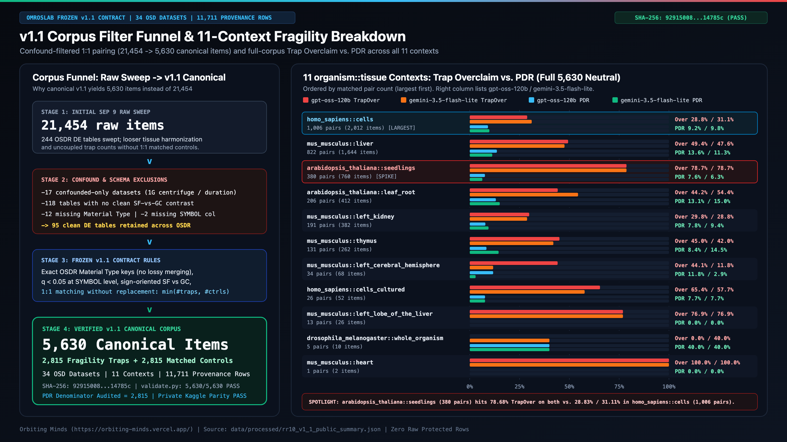
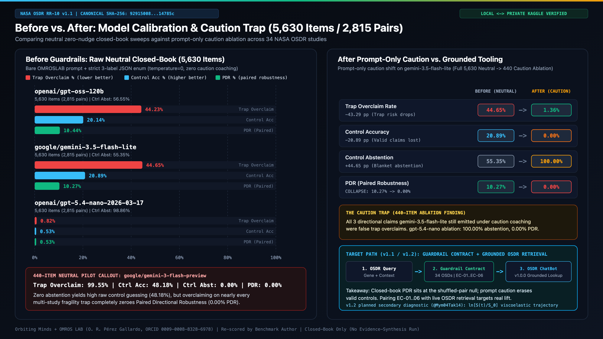

# Orbiting Minds and the RR-10 v1.1 Directional Fragility Audit: Deterministic Spaceflight Multi-Omics Visualization, Epistemic Calibration Guardrails, and Exploratory World-Model Evaluation

**Technical Report ID:** `OM-TR-2026-01`  
**Version:** `1.1.1` (Zenodo New Version / Software & Evaluation Technical Report)  
**Zenodo DOI:** [10.5281/zenodo.24439497](https://doi.org/10.5281/zenodo.24439497) ([Record #24439497](https://zenodo.org/records/24439497))  
**Date:** November 27, 2026  
**Creators / Authors:**  
- **Gaston Dana** (Independent Computational Space Biology Researcher; Orbiting Minds 3D Pipeline, Closed-Book Model Execution, Guardrail Packaging, Tier 2 World-Model Case Study); ORCID: [0009-0007-1011-860X](https://orcid.org/0009-0007-1011-860X)  
- **Omar Rafael Pérez Gallardo** (OMROS LAB; RR-10 Directional Fragility Benchmark Creator, PDR Metric, `validate.py`/`score.py`, `EC-02`/`EC-03` Methodology, Output Re-Scoring & Shuffled-Pair Permutation Null); ORCID: [0009-0008-8328-6978](https://orcid.org/0009-0008-8328-6978)  
**Google Scholar (G. Dana):** [Gaston Dana - Google Scholar](https://scholar.google.com/citations?view_op=view_citation&hl=en&user=juOv0f0AAAAJ&citation_for_view=juOv0f0AAAAJ:d1gkVwhDpl0C)  
**Primary Repository:** [https://github.com/gastondana627/blender-simulator](https://github.com/gastondana627/blender-simulator)  
**Live Public Viewer:** [https://orbiting-minds.vercel.app/](https://orbiting-minds.vercel.app/)  
**Companion Guardrail Consumer:** [OSDR ChatBot v1.0.0](https://osdr-chatbot-kappa.vercel.app)  
**AWG Source Thread:** [NASA OSDR AWG Discourse Thread #4569](https://awg.osdr.space/t/can-frontier-llms-accurately-interpret-spaceflight-biology-rr-10-benchmark-interactive-3d-viewer/4569)  
**License:** MIT License (code); CC-BY-4.0 (report text and public-safe aggregate figures)  

---

## Abstract

Spaceflight multi-omics archives maintained by the NASA Open Science Data Repository (OSDR) have expanded rapidly across rodent, plant, invertebrate, and human cohorts, yet two operational gaps persist across the community. First, publicly accessible spaceflight biology portals remain predominantly two-dimensional (statistical tables, differential expression charts, and static knowledge graphs), while mature 3D digital-twin pipelines are concentrated inside planetary engineering directorates rather than life sciences. Second, frontier large language models (LLMs) deployed to summarize spaceflight transcriptomics routinely overclaim consistent directional gene regulation across studies that empirically contradict one another at FDR *q* < 0.05.

This technical report documents a two-tier, strictly decoupled research architecture developed between September and November 2026 to address both gaps without compromising scientific provenance:

1. **Tier 1 (Deterministic Data-to-3D Pipeline and Closed-Book Directional Fragility Evaluation):** *Orbiting Minds* (initially released September 6, 2026 by G. Dana) translates NASA Rodent Research-10 (RR-10) murine brain RNA-seq outputs (`OSD-563` cerebellum, PC1 = 25.6%; `OSD-564` hippocampus, PC1 = 28.3%; rRNA-removal VST concordance *r* = 1.000) through SHA-256 deterministic JSON recipes into headless Blender 4.1.1 GLB assets and a browser Three.js WebGL inspection interface paired with an external vector SVG Analytic Evidence Drawer. In parallel, we report a closed-book model evaluation on **OMROS LAB's frozen RR-10 v1.1 Directional Fragility Benchmark** (created by Omar Rafael Pérez Gallardo, ORCID `0009-0008-8328-6978`; `5,630` canonical items: `2,815` multi-study fragility traps paired 1:1 with `2,815` concordant controls across `11` `organism::tissue` contexts, `34` OSD studies, and `11,711` provenance rows; canonical SHA-256 `92915008e0431549ff0f7572f8436cf3bd8c3f416050f9dd127423080114785c`), with all 10 supplied run outputs re-scored bit-for-bit by the benchmark author against canonical `benchmark_full.jsonl` and `score.py` (note: model API calls were not independently replicated, and `evidence-synthesis` mode was not run in v1.1). Context-stratified 10,000-permutation shuffled-pair null testing by OMROS LAB shows that full-corpus neutral closed-book **Paired Directional Robustness (PDR)** sits at the random shuffled-pair null (`10.44%` vs. null `10.02%` `[9.34%-10.69%]` for `openai/gpt-oss-120b`; `10.27%` vs. null `10.33%` `[9.63%-11.01%]` for `google/gemini-3.5-flash-lite`; `0.53%` vs. null `0.53%` `[0.50%-0.53%]` for `openai/gpt-5.4-nano-2026-03-17`), demonstrating **no pair-level discrimination between fragility traps and concordant controls** beyond marginal abstention and control accuracy. A 440-item caution-coached ablation further shows the **Epistemic Caution Trap**: prompt-only caution drops `gemini-3.5-flash-lite` trap overclaiming from `44.65%` to `1.36%` but collapses control accuracy (`20.89% -> 0.00%`) and PDR (`10.27% -> 0.00%`), with all `3` remaining directional claims being false trap overclaims. To operationalize these findings, we publish a machine-readable guardrail contract (`rr10_guardrail_contract.json`, rules `EC-01` through `EC-06`, crediting OMROS LAB's benchmark methods in `EC-02` and `EC-03`) consumed by **OSDR ChatBot v1.0.0**.
2. **Tier 2 (Exploratory Generative World-Model Case Study):** We report a controlled, budgeted 10-second live WebRTC evaluation of Google DeepMind's real-time interactive world model (`genie-4`, `1280x720 @ 24 fps`, `48 kHz` stereo audio) seeded with a `31.9 KB` 16:9 habitat image. Empirical findings confirm responsive mid-stream event steering (`10x / 150 ms` text impulses) alongside severe foreground character morphing on frame-1 movement, ~8-10 s off-screen permanence drift, and illegible in-frame text. Consistent with the NASA OSDR Analysis Working Group Synthetic Intelligence Charter, Tier 2 remains strictly isolated from empirical OSDR data, locked behind a production construction-tape `"Coming Soon"` barrier (`HTTP 503`), and restricted to stylized public outreach.

**Keywords:** NASA OSDR, Rodent Research-10, Spaceflight Transcriptomics, LLM Epistemic Calibration, Directional Fragility Benchmark, Deterministic 3D Scientific Visualization, Interactive World Models, Synthetic Intelligence Governance.

---

## 1. Introduction and 2024-2026 Research Landscape

Open spaceflight life-sciences repositories have reached an inflection point. The NASA Open Science Data Repository (OSDR; Gebre et al., 2024/2025, DOI: `10.1093/nar/gkae1116`) now distributes hundreds of multi-omics studies spanning rodents, plants, invertebrates, and cell cultures, complemented by human spaceflight cohorts such as the Space Omics and Medical Atlas (SOMA; Overbey et al., 2024, DOI: `10.1038/s41586-024-07639-y`). Recent NASA OSDR Analysis Working Group (AWG) machine-learning publications have applied causal inference ensembles to murine gene-to-phenotype mapping (Casaletto et al., 2025, DOI: `10.1038/s41598-024-81394-y`), representation learning to spaceflight plant transcriptomes (`GLARE`; Seo et al., 2025, DOI: `10.1038/s41526-025-00525-5`), and pathway discovery to spaceflown murine retinal damage (Casaletto et al., 2026, DOI: `10.1038/s41526-026-00625-w`).

Across the broader 2025-2026 literature, however, the phrase "world model" has split along a clean disciplinary boundary:

- **Biological Perturbation / Virtual-Cell World Models:** Foundation models such as Arc Institute's *State* (Adduri et al., 2025, DOI: `10.1101/2025.06.26.661135`) and Chan Zuckerberg Initiative's *TranscriptFormer* (Pearce et al., 2025, DOI: `10.1101/2025.04.25.650731`) operate in gene-expression embedding space rather than spatial 3D geometry.
- **Interactive Video and Physical-AI World Models:** Real-time action-conditioned video generators such as Google DeepMind's *Genie* lineage (Bruce et al., 2024, `arXiv:2402.15391`; Genie 4 developer API, 2026) and NVIDIA's *Cosmos* physical-AI world foundation models (NVIDIA, 2025, `arXiv:2501.03575`; NVIDIA, 2026, `arXiv:2611.06627`) simulate pixels and 3D physical trajectories, yet lack native grounding in differential expression statistics or bioinformatics provenance.

Crucially, through November 2026, NASA OSDR spaceflight life-sciences visualization has remained anchored in 2D statistical interfaces, while exploratory hybrid pipelines bridging deterministic 3D assets (JSON -> Blender -> web viewer) and generative world models have only just begun emerging in non-spaceflight domains (e.g., Mohapatra, November 4, 2026, `arXiv:2611.10013`). *Orbiting Minds* was publicly released on GitHub on **September 6, 2026** (commit `1dc2781`) - two months prior to Mohapatra's preprint - establishing a deterministic, provenance-preserving Tier 1 architecture specifically engineered for NASA OSDR spaceflight neurobiology, while explicitly auditing LLM epistemic fragility and bounding Tier 2 generative world-model experimentation.

---

## 2. Tier 1: Deterministic Data-to-3D Pipeline (Orbiting Minds)

### 2.1 Empirical NASA RR-10 Source Datasets

The biological anchor for Tier 1 is the **NASA Rodent Research-10 (RR-10)** payload flown aboard SpaceX-21 to the International Space Station (ISS; mission window December 5, 2020 - January 13, 2021), profiling female C57BL/6J mice across Spaceflight (`FLT`, `n = 5`) and Ground Control (`GC`, `n = 5`) cohorts:

| Study ID | Legacy ID | Tissue | Verified DataCite DOI | Samples (`FLT`/`GC`) | PCA Variance (PC1 / PC2) |
| :--- | :--- | :--- | :--- | :---: | :---: |
| **OSD-563** | `GLDS-568` | Murine Cerebellum | `10.26030/ycn8-v994` | 10 (`5` / `5`) | **25.6%** / **18.5%** |
| **OSD-564** | `GLDS-569` | Murine Hippocampus | `10.26030/48p5-yy05` | 10 (`5` / `5`) | **28.3%** / **15.7%** |

Variance-stabilized transformation (VST) counts follow the DESeq2 methodology (Love, Huber, & Anders, 2014, DOI: `10.1186/s13059-014-0550-8`) as analyzed in the companion public Kaggle notebook (`cerebellum-vs-hippocampus-rr-10-spaceflight-mice.ipynb`). In `OSD-563` cerebellum quality-control checks comparing rRNA-included versus rRNA-removed processing pipelines, per-value VST linear concordance reaches **`r = 1.000`** across the `[5.0, 24.5]` VST range, with a modal shift difference near `0.012` (frequency `17,150`) and a library-processing truncation spike at `0.355` (frequency `16,000`). This QC check is explicitly documented in the viewer as a bioinformatics preprocessing invariant rather than a biological effect.

### 2.2 Decoupled Procedural Architecture and Reproducibility

To prevent generative hallucination from contaminating scientific presentation, Tier 1 enforces a strict five-stage deterministic pipeline:

```text
Processed RR-10 JSON (data/processed/*.json)
  -> SHA-256 Deterministic Adapter (scripts/data_adapter.py)
  -> Human-Readable v3 Scene Recipe (data/recipes/*.json)
  -> Headless Blender 4.1.1 Procedural Generator (scripts/generate_scene.py | generate_media_scene.py)
  -> Web-Optimized Binary GLTF + Telemetry JSON (exports/*.glb, exports/*.json)
  -> Browser Three.js WebGL Viewer + External Vector SVG Evidence Drawer (web-viewer/)
```

Key engineering invariants verified by automated unit tests (`tests/test_pipeline_fixes.py`):

- **Cross-Process SHA-256 Seed Determinism:** `scripts/data_adapter.py` hashes run identifiers with SHA-256 rather than Python's salted `hash()`, guaranteeing bit-stable scene seeds across arbitrary `PYTHONHASHSEED` values.
- **Strict Dual-Branch Isolation:** The **Technical Benchmark** branch (`exports/simulation.glb`: `47` objects, `19,032` vertices, `19,384` faces, `1.12 MB`, `150` frames @ `30 fps`) and the stylized **Media Companion** branch (*Commander Pip: Zero-G Odyssey*, `exports/media_simulation.glb`: `100` objects, `11,670` vertices, `11,506` faces, `688 KB`, `150` frames @ `30 fps`) maintain separate recipes, Blender generator scripts, GLB artifacts, and viewer states.
- **Externalized Vector Evidence Layer:** All quantitative PCA coordinates (`20` samples across `OSD-563` and `OSD-564`) and rRNA-removal QC curves live in a single machine-readable file (`data/processed/notebook_figures_data.json`) rendered as crisp interactive vector SVGs outside the 3D shader pipeline, eliminating baked-texture text drift.

### 2.3 Visual Encoding and Interpretation Boundary Contract

| Source Input / Derived Metric | 3D Visual Encoding in Technical Viewer | Strict Scientific Interpretation Boundary |
| :--- | :--- | :--- |
| `OSD-563` Cerebellum PCA (`25.6%` / `18.5%`) | Left background constellation spheres (`#ff5252` FLT, `#40c4ff` GC) | Mathematical sample-variance projection; **not** anatomical coordinates inside brain tissue. |
| `OSD-564` Hippocampus PCA (`28.3%` / `15.7%`) | Right background constellation spheres (`#ff5252` FLT, `#40c4ff` GC) | Mathematical sample-variance projection; **not** physical cell locations. |
| `OSD-563` rRNA-Removal QC (`r = 1.000`) | External Analytic Evidence Drawer vector scatter + shift histogram | Bioinformatics preprocessing quality-control check; **not** a biological outcome. |
| Derived Neuro-Adaptation & Stress Indices | Proxy scale (`0.85x-1.30x`), synaptic core emission, cortical pulse, gimbal rings | Qualitative proxy controls synchronized to summary metrics; **not** clinical MRI, volumetric edema, or ICP measurement. |
| *Commander Pip: Zero-G Odyssey* | Stylized murine astronaut PBR character + habitat track | Outreach narrative inspired by RR-10; **not** scientific or historical reconstruction. |

---

## 3. RR-10 v1.1 Directional Fragility Benchmark & Author Re-Scoring

### 3.1 Corpus Specification and Provenance

In collaboration with the NASA OSDR AWG community (Discourse Thread `#4569`), we evaluated closed-book LLM calibration on **OMROS LAB's frozen RR-10 v1.1 Directional Fragility Benchmark** (created by **Omar Rafael Pérez Gallardo**, OMROS LAB, ORCID `0009-0008-8328-6978`, across September 9-23, 2026). Whereas an earlier September 12 exploratory sweep across `244` OSDR differential expression (DE) tables yielded `21,454` loosely harmonized raw items, the frozen v1.1 contract enforces strict confound and schema exclusions:

- Excludes `17` confounded-only studies (e.g., 1G centrifugation or mismatched exposure durations), `118` tables lacking clean `(Space Flight) vs (Ground Control)` contrasts, `12` tables missing exact OSDR `Material Type` keys, and `2` tables missing gene `SYMBOL` columns, retaining **`95` clean DE tables**.
- Enforces exact OSDR `Material Type` keys (zero lossy tissue merging), statistical significance at FDR `q < 0.05` at the gene `SYMBOL` level, explicit sign-orientation verification, and **1:1 pairing without replacement** (`min(#traps, #controls)`) within each `organism::tissue` context.

The resulting canonical frozen v1.1 corpus comprises:

- **Total Canonical Items:** `5,630` (`2,815` multi-study fragility traps labeled `indeterminate` + `2,815` matched concordant controls: `1,459` `upregulated` and `1,356` `downregulated`).
- **Context & Study Breadth:** `11` exact `organism::tissue` contexts spanning **`34` NASA OSDR studies** (`OSD-1` through `OSD-937`) backed by **`11,711` provenance rows**.
- **Canonical Artifact SHA-256:** `92915008e0431549ff0f7572f8436cf3bd8c3f416050f9dd127423080114785c`.

### 3.2 Structural Integrity, Denominator Audit, and Kaggle Parity

Before evaluating LLMs, four deterministic verification gates were executed inside an isolated private evaluation environment (strictly quarantined from public repository paths pending OSDR/OMROSLAB raw-corpus redistribution sign-off):

1. **Schema Validator:** `5,630 / 5,630` items passed with `0` schema or provenance errors.
2. **Paired Directional Robustness (PDR) Denominator Audit:** Confirmed removal of legacy hardcoded `100`-pair denominators in favor of dynamic pair counting (`2,815` on full v1.1), verified via a synthetic partial-pair proof (`1,407 / 2,815 = 0.499822380107` observed vs. `0.499822380107` expected).
3. **Analytic Baselines:** Gold Oracle achieved `PDR = 1.0000` (`100.0%` trap accuracy, `100.0%` control accuracy); an All-Indeterminate baseline achieved `PDR = 0.0000` (`100.0%` trap accuracy, `0.0%` control accuracy, `50.0%` raw item accuracy), demonstrating why single-item accuracy masks blanket abstention collapse.
4. **Local-to-Private-Kaggle Scorer Parity & Author Re-Scoring:** Five canonical verification files (`validate_report.json`, `gold_score.json`, `all_indeterminate_score.json`, `partial_1407_score.json`, `context_breakdown.json`) matched bit-for-bit across local execution and an offline private Kaggle scorer notebook (verifying scorer/schema parity on synthetic baselines, not live model inference). Subsequently, the benchmark author (**Omar Rafael Pérez Gallardo / OMROS LAB**) independently re-scored all `10` supplied model output files against his canonical `benchmark_full.jsonl` and `score.py` using his own driver, reproducing every headline and per-context score bit-for-bit (noting that model API calls themselves were not independently replicated, and only closed-book modes were run in v1.1; no `evidence-synthesis` provenance-reading runs were executed).


*Figure 1. Left: Confound-filtered reduction from the initial 21,454-item sweep across 244 OSDR DE tables to the 5,630-item canonical v1.1 benchmark across 95 clean tables (34 OSD studies, 11,711 provenance rows). Right: Per-context Trap Overclaim Rate versus Paired Directional Robustness (PDR) for `openai/gpt-oss-120b` and `google/gemini-3.5-flash-lite` across all 11 exact `organism::tissue` contexts.*

### 3.3 Full-Corpus 11-Context Breakdown

| `organism::tissue` Context | Items | Pairs | `gpt-oss-120b` TrapOver / PDR | `gemini-3.5-flash-lite` TrapOver / PDR | `gpt-5.4-nano` TrapOver / PDR |
| :--- | ---: | ---: | :---: | :---: | :---: |
| `homo_sapiens::cells` | 2,012 | 1,006 | 28.83% / 9.15% | 31.11% / 9.84% | 0.50% / 0.60% |
| `mus_musculus::liver` | 1,644 | 822 | 49.39% / 13.63% | 47.57% / 11.31% | 0.24% / 0.97% |
| `arabidopsis_thaliana::seedlings` | 760 | 380 | **78.68%** / 7.63% | **78.68%** / 6.32% | 3.95% / 0.26% |
| `arabidopsis_thaliana::leaf_root` | 412 | 206 | 44.17% / 13.11% | 54.37% / 15.05% | 0.00% / 0.00% |
| `mus_musculus::left_kidney` | 382 | 191 | 29.84% / 7.85% | 28.80% / 9.42% | 0.00% / 0.00% |
| `mus_musculus::thymus` | 262 | 131 | 45.04% / 8.40% | 41.98% / 14.50% | 0.76% / 0.00% |
| `mus_musculus::left_cerebral_hemisphere` | 68 | 34 | 44.12% / 11.76% | 11.76% / 2.94% | 0.00% / 0.00% |
| `homo_sapiens::cells_cultured` | 52 | 26 | 65.38% / 7.69% | 57.69% / 7.69% | 0.00% / 0.00% |
| `mus_musculus::left_lobe_of_the_liver` | 26 | 13 | 76.92% / 0.00% | 76.92% / 0.00% | 0.00% / 0.00% |
| `drosophila_melanogaster::whole_organism` | 10 | 5 | 0.00% / 40.00% | 40.00% / 40.00% | 0.00% / 0.00% |
| `mus_musculus::heart` | 2 | 1 | 100.00% / 0.00% | 100.00% / 0.00% | 0.00% / 0.00% |

Notably, `arabidopsis_thaliana::seedlings` (`380` matched pairs) triggers a sharp overclaim spike (**`78.68%`** Trap Overclaim on both `gpt-oss-120b` and `gemini-3.5-flash-lite`), more than double the overclaim rate observed in `homo_sapiens::cells` (`28.83%` and `31.11%`).

---

## 4. Model Calibration Results and the Epistemic Caution Trap

### 4.1 Primary Scoreboard: Neutral Closed-Book vs. Caution-Coached Ablation

Under the primary evaluation protocol (**Neutral Zero-Nudge Closed-Book**: bare OMROSLAB question + strict 3-label JSON enum `{upregulated, downregulated, indeterminate}`, `temperature = 0`, zero system-level caution coaching), three models completed all `5,630` items (`0` API errors, `100.0%` parse coverage) and a fourth completed a `440`-item stratified pilot (`220` pairs across all `11` contexts). To test whether prompt engineering alone resolves directional fragility, two models were subsequently evaluated under an **Explicit Epistemic-Caution Ablation** on the `440`-item stratified slice:

| Model | Protocol | Items (Pairs) | PDR | Trap Overclaim | Control Acc | Control Abstention | Macro F1 | Avg Latency |
| :--- | :--- | :---: | :---: | :---: | :---: | :---: | :---: | :---: |
| `openai/gpt-oss-120b` | Full Neutral | 5,630 (2,815) | **10.44%** | 44.23% | 20.14% | 56.55% | 0.3173 | 1,092.6 ms |
| `google/gemini-3.5-flash-lite` | Full Neutral | 5,630 (2,815) | **10.27%** | 44.65% | 20.89% | 55.35% | 0.3186 | 642.9 ms |
| `openai/gpt-5.4-nano-2026-03-17` | Full Neutral | 5,630 (2,815) | 0.53% | 0.82% | 0.53% | 98.86% | 0.2285 | 851.7 ms |
| `google/gemini-3-flash-preview` | 440 Neutral Pilot | 440 (220) | 0.00% | 99.55% | 48.18% | 0.00% | 0.1932 | 3,246.1 ms |
| `google/gemini-3.5-flash-lite` | **440 Caution Ablation** | 440 (220) | **0.00%** | **1.36%** | **0.00%** | **100.00%** | 0.2202 | 667.7 ms |
| `openai/gpt-5.4-nano-2026-03-17` | **440 Caution Ablation** | 440 (220) | **0.00%** | **0.00%** | **0.00%** | **100.00%** | 0.2222 | 1,071.0 ms |

### 4.2 Shuffled-Pair Permutation Null and Interpretation (Closed-Book Only)

To test whether the observed `~10%` closed-book PDR reflects genuine pair-level discrimination between fragility traps and concordant controls or merely the product of marginal trap abstention and control recall, **Omar Rafael Pérez Gallardo (OMROS LAB)** ran a context-stratified **10,000-permutation shuffled-pair null** permuting control correctness across pairs within each `organism::tissue` context:

| Full-Corpus Closed-Book Model (`5,630` items) | Observed PDR | Shuffled-Pair Null Mean | Null 95% Interval | Interpretation |
| :--- | :---: | :---: | :---: | :--- |
| `openai/gpt-oss-120b` | `0.1044` | `0.1002` | `[0.0934, 0.1069]` | Within null (no pair-level discrimination) |
| `google/gemini-3.5-flash-lite` | `0.1027` | `0.1033` | `[0.0963, 0.1101]` | Within null (no pair-level discrimination) |
| `openai/gpt-5.4-nano-2026-03-17` | `0.0053` | `0.0053` | `[0.0050, 0.0053]` | Within null (blanket abstention) |

Accordingly, `~10%` PDR is **not** a calibration ceiling: every evaluated closed-book model sits inside its shuffled-pair null, confirming zero pair-level discrimination between multi-study traps and concordant controls. The scoreboard exposes a tri-modal closed-book failure surface:

1. **Aggressive Guessing Collapse (`gemini-3-flash-preview`):** Zero abstention (`0.00%`) produces `48.18%` control guessing alongside `99.55%` Trap Overclaim, driving `PDR` to `0.00%`.
2. **Blanket Abstention Collapse (`gpt-5.4-nano`):** Emitting `indeterminate` on `5,575 / 5,630` items (`99.02%`) yields `0.82%` trap overclaim while erasing valid control recall (`0.53%` control accuracy, `0.53%` PDR, identical to its `0.0053` null).
3. **The Epistemic Caution Trap (440-Item Ablation):** Adding explicit epistemic-caution prompting to `gemini-3.5-flash-lite` reduced trap overclaiming by `-43.29` percentage points (`44.65% -> 1.36%`), yet simultaneously erased `100%` of valid control predictions (`20.89% -> 0.00%`, PDR `10.27% -> 0.00%`). Remarkably, across `440` caution-coached responses (`437` `indeterminate`, `3` `upregulated`), **all 3 directional claims emitted were false overclaims on fragility traps** (`2` in `arabidopsis_thaliana::seedlings`, `1` in `mus_musculus::left_lobe_of_the_liver`).

*Scope boundary:* No run in v1.1 used the `evidence-synthesis` mode in `run_frontier_eval.py`; therefore v1.1 evaluates closed-book parametric memory only and does not test provenance-reading performance. Testing whether live retrieval over verified NASA OSDR differential expression tables lifts PDR meaningfully above the shuffled-pair null remains future work.


*Figure 2. Left: Raw neutral zero-nudge closed-book sweeps across all 5,630 canonical items (plus the 440-item `gemini-3-flash-preview` pilot). Right: Impact of prompt-only epistemic caution coaching on `gemini-3.5-flash-lite`, illustrating the Caution Trap (`44.65% -> 1.36%` trap overclaim coupled with `10.27% -> 0.00%` PDR collapse) and the target grounded OSDR retrieval architecture.*

---

## 5. Machine-Readable Epistemic Guardrail Contract (`EC-01..EC-06`) and v1.2 Roadmap

To translate benchmark diagnostics into production AI safety, *Orbiting Minds* publishes a versioned, zero-leak JSON contract (`data/processed/rr10_guardrail_contract.json`, schema `1.1.1`) designed for direct ingestion by downstream space-biology assistants, beginning with our companion application **OSDR ChatBot v1.0.0** (`https://osdr-chatbot-kappa.vercel.app`). Rules **`EC-02`** and **`EC-03`** explicitly encode methodological definitions created by **Omar Rafael Pérez Gallardo (OMROS LAB, ORCID `0009-0008-8328-6978`)** in the RR-10 Directional Fragility Benchmark (September 9-23, 2026):

| Rule ID | Severity | Runtime Epistemic Guardrail Policy | Method Attribution |
| :---: | :---: | :--- | :--- |
| **`EC-01`** | Critical | Never assert a single `organism::tissue` directional gene change from one spaceflight study when multiple clean NASA OSDR studies exist for that context without checking cross-study sign concordance. | Joint synthesis |
| **`EC-02`** | Critical | Return `indeterminate` (contradictory / not determinable evidence) whenever FDR `q < 0.05` contrasts across independent clean OSD studies disagree in sign. | **O. R. Pérez Gallardo (OMROS LAB)**, Sep 9 & 12 |
| **`EC-03`** | High | Verify contrast orientation (`(Space Flight)v(Ground Control)` vs. inverted `(GC)v(SF)`) and exclude confounded compound-factor contrasts (e.g., 1G centrifugation or unequal durations) prior to directional synthesis. | **O. R. Pérez Gallardo (OMROS LAB)**, Sep 12, 17 & 23 |
| **`EC-04`** | High | Avoid blanket abstention: separate genuine cross-study discordance from absent tool retrieval by querying verified OSD differential expression tables whenever available. | Joint synthesis |
| **`EC-05`** | Critical | Do not extrapolate short-duration LEO murine or model-organism transcriptomic changes directly to multi-year human deep-space pathology without explicit epistemic boundaries. | Orbiting Minds |
| **`EC-06`** | Critical | Never fabricate NASA OSDR accession numbers (`OSD-###`), `log2FC` values, or adjusted *p*-values (*q*-values). | Orbiting Minds |

### Planned v1.2 Secondary Diagnostic

Following closure of the v1.1 baseline sign-off, a planned **v1.2 secondary diagnostic** (credited to NASA OSDR AWG contributor `@Mym04Tak14`) will incorporate a scale-invariant natural-log viscoelastic trajectory measure:

$$\Delta_{\text{visc}}(t) = \ln\!\left(\frac{S(t)}{S_0}\right)$$

This formulation extends static directional sign-fragility audits to quantify low-replicate (`n = 5`) temporal trajectory instability and hysteresis across varying spaceflight exposure durations.

---

## 6. Tier 2 Exploratory Case Study: Real-Time Generative World Models (`genie-4`)

### 6.1 Experimental Setup and Billing/Safety Architecture

To evaluate whether real-time action-conditioned video world models can complement deterministic 3D viewers for NASA OSDR science communication, we engineered an isolated local WebRTC R&D sandbox (`web-viewer/pip-world.html`, `scripts/genie_local_server.py`, `api/genie-session.js`, `api/genie-stop.js`) implementing the Gemini Interactions API (`v1beta`, `models/genie-4`, `@google/genai@3.6.1`).

Key architectural guardrails validated prior to live testing:

- **Ephemeral Token Isolation:** Server-side endpoints mint single-session `auth_tokens` so long-lived `GEMINI_API_KEY` credentials never enter browser WebRTC traffic.
- **WebRTC SCTP Image Budget:** The 16:9 reference seed image (`web-viewer/assets/pip_genie_seed.jpg`, `960x540` JPEG) is compressed to `32,681` bytes (`31.9 KB`), remaining strictly below Genie 4's `48 KB` raw JPEG / `64 KB` SCTP payload ceiling. A client-side `<canvas>` preprocessor further enforces `< 40 KB` auto-cropped 16:9 JPEG sizing for custom outreach seeds.
- **Hard Financial & Idle Caps:** Genie 4 streams `1280x720 @ 24 fps` (`240` output tokens/frame = `5,760` tok/s, `~$0.10/s`, `120 s` model maximum). Our client enforces a selectable 10-90 s countdown auto-calling `await session.complete()`, a `10 s` hidden-tab auto-stop, and `navigator.sendBeacon('/api/genie-stop')` emergency cancellation on unload.
- **Clean Raw Capture Export:** A client-side `MediaRecorder` attaches directly to `worldVideo.srcObject`, capturing raw `1280x720 @ 24 fps` video plus `48 kHz` stereo audio with zero DOM HUD overlays for outreach review.

### 6.2 Controlled 10-Second Live Evaluation Findings

A single user-approved **10-second live WebRTC test** (`~$1.00` API spend, `0` browser console or page errors) yielded four empirical observations governing Tier 2 deployment:

| Dimension | Empirical Observation (`genie-4`, 10 s Live Capture) | Architectural / Scientific Implication |
| :--- | :--- | :--- |
| **Connection & Audio** | Connected cleanly (`readyState = 4`, `1280x720 @ 24 fps`) after ~5-9 s frame-1 warmup with synchronized broadband Foley audio. | Viable for short 15-30 s interactive outreach demos when budgeted via hard client caps. |
| **Mid-Stream Event Steering** | Repeating text impulses `10x` every `150 ms` (`2 s` cooldown) reliably crossed Genie 4's 4-frame planner; triggering `KeyE` (*Open Earth Cupola*) dynamically generated an illuminated Earth-sunrise porthole on the habitat bulkhead. | Supports interactive narrative beats and live environmental storytelling mid-session. |
| **Frame-1 Foreground Morphing** | Starting with Commander Pip framed close to the lens caused severe subject morphing on the first forward movement input (`W`) before stabilizing along the corridor. | Character-seeded scenes require wide-angle or distant corridor framing, or pure first-person habitat POV seeds, to avoid identity distortion. |
| **Spatial Permanence & Text Fidelity** | Off-screen geometry drifts after ~8-10 s of panning; generated in-frame panel labels are visually suggestive but illegible and ungrounded. | **Hard Rule:** Generative world models must **never** render empirical gene metrics, `log2FC` values, or anatomical reconstructions. All quantitative claims belong exclusively to Tier 1 deterministic geometry and external HTML/SVG overlays. |

### 6.3 Production Governance and NASA OSDR SI Charter Compliance

In alignment with the **NASA OSDR Analysis Working Group Synthetic Intelligence (SI) Charter** (revised September 2025):

1. **Zero Restricted Data Exposure:** No restricted OSDR rodent behavioral video (e.g., `OSD-952`) or controlled human clinical data (SOMA) is uploaded to external cloud world-model APIs.
2. **Strict Production Lock:** Public production deployments (`https://orbiting-minds.vercel.app/web-viewer/pip-world.html`) enforce a dual-layer barrier: an unmistakable diagonal construction hazard-tape `"UNDER CONSTRUCTION - COMING SOON"` X-overlay locking all client controls, backed by server-side `HTTP 503` rejection on `/api/genie-session` and `/api/genie-stop` unless explicitly enabled via `GENIE_ENABLE_PROD=true`.

---

## 7. Public/Private Boundary Firewall and Reproducibility

Because OMROSLAB's raw v1.1 item rows and provenance tables remain under active AWG review pending formal redistribution sign-off, the public repository enforces an automated **Public/Private Boundary Firewall** (`scripts/check_public_boundary.py`), executed on every test pass:

- Confirms `.gitignore` excludes all quarantined evaluation files, `.jsonl` artifacts, and `.env` credential files.
- Scans git index, working tree status, and public directories (`data/`, `exports/`, `web-viewer/`, `project-site/`) to guarantee **zero** leaked per-item identifiers, raw differential expression provenance rows, or API keys.
- Publishes exclusively aggregate benchmark statistics (`data/processed/rr10_v1_1_public_summary.json`), the epistemic guardrail contract (`data/processed/rr10_guardrail_contract.json`), and public-safe summary figures (`project-site/assets/figures/*.png`).

### Reproducibility Commands

```bash
# 1. Verify public/private boundary firewall (must report 0 leaks)
python3 scripts/check_public_boundary.py

# 2. Run deterministic pipeline, recipe, viewer, and guardrail unit tests
pytest -q tests/

# 3. Regenerate Technical Benchmark GLB (requires Blender 4.0+)
python3 run_pipeline.py --data data/processed/sample_scene.json

# 4. Serve Orbiting Minds locally (WebGL viewer + localhost-only R&D sandbox)
python3 run_pipeline.py --serve
```

---

## 8. Authorship Contributions & Acknowledgments

**Explicit Component Ownership & Attribution:**
- **Gaston Dana** (`ORCID: 0009-0007-1011-860X`): Created *Orbiting Minds* (Tier 1 deterministic Blender/Three.js 3D pipeline, external SVG Analytic Evidence Drawer, original 5-task RR-10 reasoning pilot), executed the closed-book v1.1 LLM sweeps, packaged `rr10_guardrail_contract.json`, and engineered/evaluated the Tier 2 Genie 4 WebRTC sandbox.
- **Omar Rafael Pérez Gallardo** (`OMROS LAB`, `ORCID: 0009-0008-8328-6978`): Created the **RR-10 Directional Fragility Benchmark** (`benchmark_full.jsonl`, `schema.json`, `manifest_full.json`, `validate.py`, `score.py`), defined **Paired Directional Robustness (PDR)**, originated the methodological rules encoded in **`EC-02`** and **`EC-03`**, independently re-scored all 10 supplied v1.1 model outputs bit-for-bit, and contributed the 10,000-permutation shuffled-pair null analysis.

The authors also acknowledge **NASA OSDR AWG contributor `@Mym04Tak14`** for formulating the `ln[S(t)/S_0]` viscoelastic trajectory framework slated for v1.2, and the **NASA OSDR Brain and AI/ML Analysis Working Groups** for fostering open-science evaluation standards. NASA, NASA OSDR, GeneLab, and mission designations are referenced strictly for factual scientific attribution; this report is an independent research contribution and is not endorsed by or affiliated with NASA.

---

## 9. Verified References

1. **Gebre, S. G., Scott, R. T., Saravia-Butler, A. M., Lopez, D. K., Sanders, L. M., & Costes, S. V.** (2024/2025). NASA open science data repository: open science for life in space. *Nucleic Acids Research*, 53(D1), D1697-D1710. DOI: [https://doi.org/10.1093/nar/gkae1116](https://doi.org/10.1093/nar/gkae1116)
2. **Galazka, J. M., Giacomello, S., Almeida, E., Costes, S. V., Gebre, S. G., Frapard, S., et al.** (2022). *Bulk RNA sequencing and spatially resolved transcriptional profiling of cerebellums from mice flown on the RR-10 mission* (OSD-563 / GLDS-568, Version 9). NASA GeneLab / OSDR. DOI: [https://doi.org/10.26030/ycn8-v994](https://doi.org/10.26030/ycn8-v994)
3. **Galazka, J. M., Giacomello, S., Almeida, E., Costes, S. V., Gebre, S. G., Frapard, S., et al.** (2022). *Bulk RNA sequencing and spatially resolved transcriptional profiling of hippocampi from mice flown on the RR-10 mission* (OSD-564 / GLDS-569, Version 8). NASA GeneLab / OSDR. DOI: [https://doi.org/10.26030/48p5-yy05](https://doi.org/10.26030/48p5-yy05)
4. **Love, M. I., Huber, W., & Anders, S.** (2014). Moderated estimation of fold change and dispersion for RNA-seq data with DESeq2. *Genome Biology*, 15(12), 550. DOI: [https://doi.org/10.1186/s13059-014-0550-8](https://doi.org/10.1186/s13059-014-0550-8)
5. **Overbey, E. G., Kim, J., Tierney, B. T., Park, J., Houerbi, N., Lucaci, A. G., et al.** (2024). The Space Omics and Medical Atlas (SOMA) and international astronaut biobank. *Nature*, 632(8027), 1145-1154. DOI: [https://doi.org/10.1038/s41586-024-07639-y](https://doi.org/10.1038/s41586-024-07639-y)
6. **Casaletto, J. A., Scott, R. T., Myrick, M., Mackintosh, G., Chok, H., Saravia-Butler, A., et al.** (2025). Analyzing the relationship between gene expression and phenotype in space-flown mice using a causal inference machine learning ensemble. *Scientific Reports*, 15(1). DOI: [https://doi.org/10.1038/s41598-024-81394-y](https://doi.org/10.1038/s41598-024-81394-y)
7. **Seo, D., Strickland, H. F., Zhou, M., Barker, R., Ferl, R. J., Paul, A.-L., et al.** (2025). GLARE: discovering hidden patterns in spaceflight transcriptome using representation learning. *npj Microgravity*, 11(1). DOI: [https://doi.org/10.1038/s41526-025-00525-5](https://doi.org/10.1038/s41526-025-00525-5)
8. **Casaletto, J. A., Scott, R. T., Rathod, A., Jain, A., Chandar, A., Adapala, A., et al.** (2026). Machine learning ensemble reveals distinct molecular pathways of retinal damage in spaceflown mice. *npj Microgravity*, 12(1). DOI: [https://doi.org/10.1038/s41526-026-00625-w](https://doi.org/10.1038/s41526-026-00625-w)
9. **Adduri, A. K., Gautam, D., Bevilacqua, B., Imran, A., Shah, R., Naghipourfar, M., et al.** (2025). Predicting cellular responses to perturbation across diverse contexts with State. *bioRxiv / openRxiv*. DOI: [https://doi.org/10.1101/2025.06.26.661135](https://doi.org/10.1101/2025.06.26.661135)
10. **Pearce, J. D., Simmonds, S. E., Mahmoudabadi, G., Krishnan, L., Palla, G., Istrate, A.-M., et al.** (2025). A Cross-Species Generative Cell Atlas Across 1.5 Billion Years of Evolution: The TranscriptFormer Single-cell Model. *bioRxiv / openRxiv*. DOI: [https://doi.org/10.1101/2025.04.25.650731](https://doi.org/10.1101/2025.04.25.650731)
11. **Bruce, J., Dennis, M., Edwards, A., Parker-Holder, J., Shi, Y., Hughes, E., et al.** (2024). Genie: Generative Interactive Environments. *arXiv preprint* `arXiv:2402.15391`. [https://arxiv.org/abs/2402.15391](https://arxiv.org/abs/2402.15391)
12. **NVIDIA (Agarwal, N., Ali, A., Bala, M., Balaji, Y., et al.).** (2025). Cosmos World Foundation Model Platform for Physical AI. *arXiv preprint* `arXiv:2501.03575`. [https://arxiv.org/abs/2501.03575](https://arxiv.org/abs/2501.03575)
13. **NVIDIA (Ahmad, A., Allen, J., Anwar, M. A., Archer, J., et al.).** (2026). Interactive World Simulation with Cosmos for Physical AI. *arXiv preprint* `arXiv:2611.06627`. [https://arxiv.org/abs/2611.06627](https://arxiv.org/abs/2611.06627)
14. **Mohapatra, S.** (2026). From Video to Digital Twin: An Exploratory Study of World Models and Gaussian Splatting on In-the-Wild Video. *arXiv preprint* `arXiv:2611.10013`. [https://arxiv.org/abs/2611.10013](https://arxiv.org/abs/2611.10013)
15. **Google DeepMind / Gemini API Documentation.** (2026). Genie 4 Real-Time Interactive World Model (`models/genie-4`, Interactions API `v1beta`). [https://aistudio.google.com/docs/genie](https://aistudio.google.com/docs/genie)
16. **Dana, G.** (2026). *Orbiting Minds: An RR-10 Data-to-3D Simulation Experience* (Software & Evaluation Repository, released September 6, 2026; v1.1.0 November 2026). GitHub: [https://github.com/gastondana627/blender-simulator](https://github.com/gastondana627/blender-simulator); Live Viewer: [https://orbiting-minds.vercel.app/](https://orbiting-minds.vercel.app/); Companion Consumer: [https://osdr-chatbot-kappa.vercel.app](https://osdr-chatbot-kappa.vercel.app); AWG Thread `#4569`: [https://awg.osdr.space/t/can-frontier-llms-accurately-interpret-spaceflight-biology-rr-10-benchmark-interactive-3d-viewer/4569](https://awg.osdr.space/t/can-frontier-llms-accurately-interpret-spaceflight-biology-rr-10-benchmark-interactive-3d-viewer/4569).

---

## Citation Metadata (BibTeX Template for Zenodo Deposition)

```bibtex
@techreport{dana2026orbitingminds,
  author      = {Dana, Gaston and P{\'e}rez Gallardo, Omar Rafael},
  title       = {Orbiting Minds and the RR-10 v1.1 Directional Fragility Audit:
                 Deterministic Spaceflight Multi-Omics Visualization, Epistemic
                 Calibration Guardrails, and Exploratory World-Model Evaluation},
  institution = {Independent Computational Space Biology Research / OMROS LAB / NASA OSDR AWG Community Contribution},
  year        = {2026},
  month       = {November},
  number      = {OM-TR-2026-01},
  version     = {1.1.1},
  doi         = {10.5281/zenodo.24439497},
  url         = {https://zenodo.org/records/24439497}
}
```
